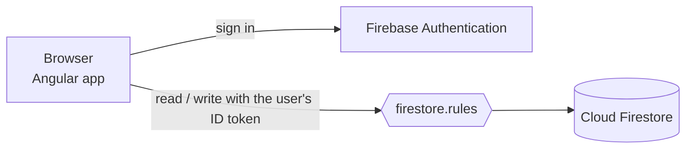
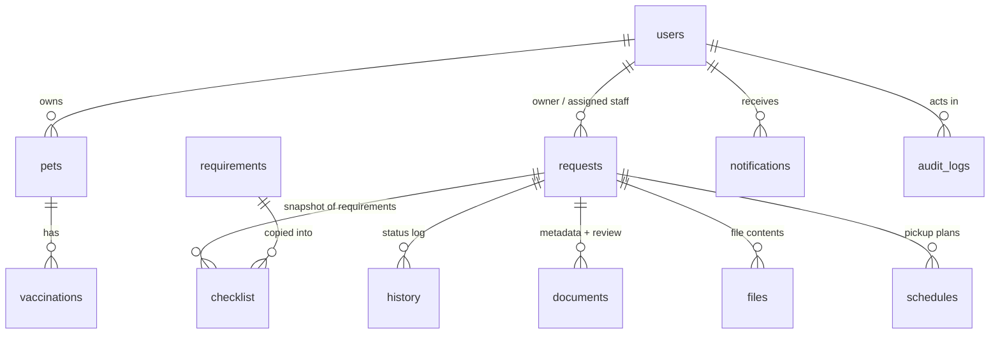

# PetTrack architecture (Firebase edition)

| Layer | Technology | Responsibility |
|---|---|---|
| Client | Angular single-page app (`src/app`) | Screens for owners, staff and administrators |
| Data layer | `src/app/api.ts` | Turns each screen action into Firebase Auth / Firestore calls; validates input; writes audit entries |
| Business rules | `src/app/rules.ts` | Pure functions: status workflow, validation, password policy, file-type sniffing, CSV safety (unit tested) |
| Identity | Firebase Authentication (email + password) | Stores credentials (salted hashes), throttles repeated failures |
| Database | Cloud Firestore | Persistent, per-user data |
| Access control | `firestore.rules` | **The real security boundary**, enforced on Google's servers |

There is no PetTrack server. Because the browser talks to the database directly, **every permission must be written in `firestore.rules`**; checks in `api.ts` exist only to give friendly messages.

## Data model (Firestore collections)

| Collection | Key fields |
|---|---|
| `users/{uid}` (uid = Firebase Auth user id) | name, email, role (`owner`/`staff`/`admin`), active, must_change_password |
| `pets/{id}` | owner_id, owner_name, name, species, ..., photo_data (small JPEG) |
| `pets/{id}/vaccinations/{id}` | vaccine_name, administered_on, expires_on |
| `requests/{id}` | reference_no, owner_id, pet_id, assigned_staff_id, status, route, requested_date, vaccinations (snapshot) |
| `requests/{id}/checklist`, `history`, `documents`, `files`, `schedules` | the sub-records of one request |
| `requirements/{id}` | reference data managed by admins |
| `notifications/{id}` | user_id, title, message, read_at |
| `audit_logs/{id}` | actor_user_id, action, record_type, outcome, created_at (append-only) |

Design decisions worth explaining in a report:
- **Denormalisation.** NoSQL has no joins, so names are copied onto the records that need them (`owner_name`, `pet_name`, `assigned_staff_name`) and the vaccination list is snapshotted into each request. This also means staff never need permission to read pet records.
- **Checklist snapshot** (same idea as the MySQL edition): later edits to a requirement do not change requests already submitted.
- **Files in the database.** Cloud Storage requires the paid plan, so a document's bytes are stored as base64 in `requests/{id}/files/{docId}` (limit about 650 KB) and its metadata in `documents`, so lists stay small.
- **Batched writes.** A request, its checklist, its first history entry, a notification and an audit entry are committed in one atomic batch.
